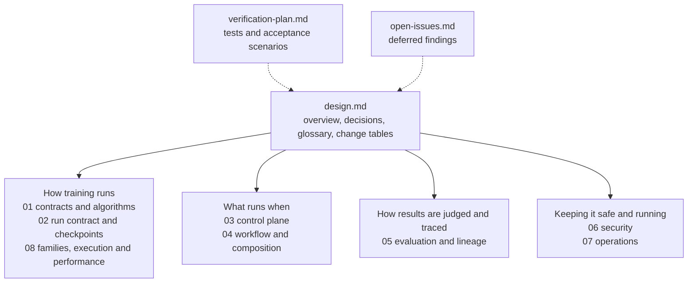

# gatedtrain-design

The design documents behind [gatedtrain](https://github.com/gatedtrain/gatedtrain). gatedtrain calls a newly trained
checkpoint better only when it beats a criterion registered before training, on test data the trainer never saw,
and records which data each training run read. This repository explains how a full framework built on that idea
would work, and why: contracts, run and checkpoint protocol, control plane, workflow and gates, evaluation statistics
and lineage, security, operations, and per-family execution for post-training LLMs, VLMs, diffusion, speech, and
control policies.

You do not need these documents to use gatedtrain. To try it, start with its
[documentation](https://gatedtrain.github.io/gatedtrain/). Read on here if you want the reasoning and the exact rules.

## Status

The framework `gatedtrain` (Python distribution `gatedtrain`, import `gatedtrain`, repository `github.com/gatedtrain/gatedtrain`) implements **revision 24** of this design except the training-seed unit of revision 20 (05 §3.3). Its code and tests cite the design by file and section (for example `05 §6.1`) and by rule ids (`R15-1`, `R18-8`, `EXT-*`, `MM-*`); file names, section numbers, and ids are the stable references; line numbers cited by the code match the revision the code was written against and may have shifted since.

This repository (`github.com/gatedtrain/gatedtrain-design`) holds the published documents of the maintainers' design set. The implementation plan, panel review records, and decision records that the documents mention are working material and are not published.

## How the documents fit together

`design.md` is the overview; each numbered document covers one area in depth. The verification plan says how the
design is tested, and the open-issues register lists what is deferred.

Where to start: `design.md` for the goals and the vocabulary; `05-evaluation-and-lineage.md` for the gate statistics,
the evaluator tiers and the consumption ledger, the parts a first-time reader of gatedtrain meets first.

## Files

| File | Content |
|---|---|
| `design.md` | Overview: goals, G0 and phases, packages, upstream hooks, decisions D1–D20, alternatives, glossary, and the change tables for revisions 10–24 |
| `01-contracts-and-algorithms.md` | NeMo RL baseline, step fields, `ModelAdapter` and `StepForward`, primitives, algorithm plug-ins, loss kernel, research profile |
| `02-run-contract-and-checkpoints.md` | Run contract and transport, provenance, checkpoint cuts, attempt- and epoch-scoped storage, fallback, refit verification |
| `03-control-plane.md` | Store requirements, leases, fencing, supervisor, placement broker, scheduler plug-ins, intents, cluster health service integration, formal verification |
| `04-workflow-and-composition.md` | Workflow spec and IR, runner and backends, gate semantics and pins, `ControlAPI` decisions, composition and alternating training |
| `05-evaluation-and-lineage.md` | Gate statistics, evaluator tiers and independence, reward-hacking detection, human feedback, lineage model, consumption ledger, reproducibility |
| `06-security.md` | Threat model, MVP security baseline, identities and secrets, plug-in trust, sandbox, egress and residency, consent, safety-critical workloads |
| `07-operations.md` | Guidance for operators: service inventory, FMEA, SLOs and SLIs, chaos tests, runbooks, budgets, upgrades and version skew |
| `08-families-execution-and-performance.md` | Execution modes, family notes, payload and performance model, placement constraints, embodied specifics, numeric targets |
| `verification-plan.md` | Test layers and ids, invariants, exit criteria, fault injection, end-to-end acceptance scenarios |
| `open-issues.md` | Deferred findings with phase gate and owner role, and calibration defaults |

## License

Apache License 2.0; see `LICENSE` and `NOTICE`. Names of third-party projects and products are trademarks of their owners; gatedtrain is not affiliated with or endorsed by them.
